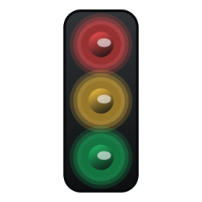

# Agent Status Light（Linux 版）

桌面红绿灯，实时显示 [Paseo](https://paseo.sh) 里所有 agent 的状态，不分供应商（Claude Code、Codex 等）。红灯：等你处理；黄灯：在干活；绿灯：做完了还没看。

- **支持系统：Ubuntu。** 在 Ubuntu 20.04（GNOME，X11 会话）上开发和测试。其他带 GTK3 的 Linux 桌面应该也能用，但没有测过。
- **源仓库：[kongkongyo/agent-status-light](https://github.com/kongkongyo/agent-status-light)。** 原项目是 Windows 版（C# WinForms），通过 Codex 会话文件和 Claude Code hooks 判断状态。这里沿用了它的三灯外观、颜色和提示规则，用 Python + GTK3 重写，状态改为从 Paseo 实时订阅。

> A floating red/yellow/green status light for the Linux desktop that shows the state of every agent managed by Paseo. Linux (Ubuntu) port of [kongkongyo/agent-status-light](https://github.com/kongkongyo/agent-status-light), which is Windows-only. Tested on Ubuntu 20.04 (GNOME, X11).

## 需要什么

- 本机在运行 Paseo 后台服务。地址会从 `~/.paseo/config.json` 读取，默认 `ws://127.0.0.1:6767/ws`。用 Paseo 0.15.2 和 0.15.3 测过。
- Python 3.8 或更高，以及 GTK3：
  ```bash
  sudo apt install python3-gi python3-gi-cairo gir1.2-gtk-3.0
  ```
- 桌面通知和提示音用到的命令（Ubuntu 桌面版一般自带）：
  ```bash
  sudo apt install libnotify-bin pulseaudio-utils
  ```
- Node.js 18 或更高。用 nvm 装的也行，程序会自己去 `~/.nvm` 里找。

## 安装

```bash
git clone https://github.com/Dorgon-CN/agent-status-light-linux.git
cd agent-status-light-linux
(cd bridge && npm ci)        # 安装 Paseo 官方 SDK
./start.sh                   # 启动
./install-desktop-entry.sh   # 可选：加到「全部应用」里
```

## 启动和停止

```bash
./start.sh   # 后台启动，关掉终端也不退出
./stop.sh
```

运行过 `install-desktop-entry.sh` 后，也可以在「全部应用」里搜「Agent 状态灯」打开，在它的图标上右键选「停止状态灯」。要从「全部应用」里移除，删掉 `~/.local/share/applications/agent-status-light.desktop` 即可。

不会开机自启。已经在运行时再打开，不会多开一个。和 Paseo 断开时灯全灭，并自动重连。

## 灯的含义

| 灯 | 什么时候亮 | 什么时候灭 |
|---|---|---|
| 红 | 有待批准的权限请求；agent 出错且还没在 Paseo 里看过（含子 agent）；Claude Code 请求报错、正在自动重试 | 批准或拒绝后马上灭；出错的在 Paseo 里看过就灭；重试成功后变回黄灯 |
| 黄 | agent 正在运行，含通过 Paseo 派出的子 agent，以及主 agent 这一轮结束后仍在后台跑的内部子 agent（如 Claude Code 的 Agent 工具） | 停止运行 |
| 绿 | 顶层 agent 做完、还没在 Paseo 里看过 | 在 Paseo 里看过就灭，或右键「清除绿灯」（只清这盏灯） |

- 灯里的数字是 agent 个数，2 个及以上才显示。
- 子 agent 做完不亮绿灯，它的结果交给主 agent。主 agent 在等子 agent 时也不亮绿灯：子 agent 都结束后，主 agent 6 秒内没有继续干活才亮。
- 红灯或绿灯变多时响提示音，并弹桌面通知，两者都可以在右键菜单里关掉。提示音从系统默认的输出设备播放；连着蓝牙耳机时，声音在耳机里。

## 操作

- 左键拖动，位置会记住。
- 鼠标悬停：按灯列出各 agent 和它们的状态。
- 右键菜单：点 agent 跳到 Paseo；设置皮肤、颜色、提示音、桌面通知、呼吸灯、方向、大小。

## 读取了什么

- 只读订阅 Paseo 的 agent 状态。不改 Paseo 和各家 agent 的配置，也不能在灯上批准权限。
- Paseo 不转发 Claude Code 中途重试时的报错，所以灯会读取 `~/.claude/projects/` 下正在运行的 Claude 会话记录的末尾，只看有没有报错条目。
- 除了连接本机的 Paseo，不联网，不上传任何东西。

## 已知限制

- 不显示在普通终端里直接开的 claude、codex，也不显示 Paseo 的后台 agent。
- Claude Code 压缩上下文时如果请求一直失败，这类重试不会写进会话记录，灯会保持黄色，不会变红。
- Codex 等其他供应商中途重试时的报错看不到，要等 Paseo 把 agent 标成出错才会变红。
- 只测过没设密码的本机 Paseo。
- Wayland 会话没测过。GNOME 在 Wayland 下不允许程序自己摆放窗口和置顶，灯的位置和置顶可能不生效。可以试 `GDK_BACKEND=x11 ./start.sh`，让它通过 XWayland 运行。

## 可选环境变量

| 变量 | 作用 |
|---|---|
| `ASL_NODE` | 指定 node 可执行文件 |
| `ASL_PASEO_URL` | 直接指定 Paseo 地址，例如 `ws://127.0.0.1:6767/ws` |
| `PASEO_HOME` | Paseo 数据目录，默认 `~/.paseo` |
| `CLAUDE_CONFIG_DIR` | Claude Code 配置目录，默认 `~/.claude` |

## 文件

- `status_light.py`：界面和分灯规则（Python 3 + GTK3）。
- `bridge/paseo-bridge.mjs`：连接 Paseo 的桥接程序（Node，`@getpaseo/client` 0.15.2），由界面程序启动，随它一起退出。Paseo 大版本升级后如果连不上，可能需要同步升级这里的 SDK 版本。
- `icon.png`：应用图标，用灯自己的绘制代码画的。
- `start.sh`、`stop.sh`：启动和停止。
- `install-desktop-entry.sh`：按仓库所在位置生成「全部应用」里的入口。
- `data/`：设置（`settings.json`）和运行状态，首次运行时自动创建，不在仓库里。
- `logs/status-light.log`：日志，灯的数量每变一次、每响一次提示音都记一行。

## 许可证

MIT，见 [LICENSE](LICENSE)，其中保留了原项目 kongkongyo/agent-status-light 的版权声明。
